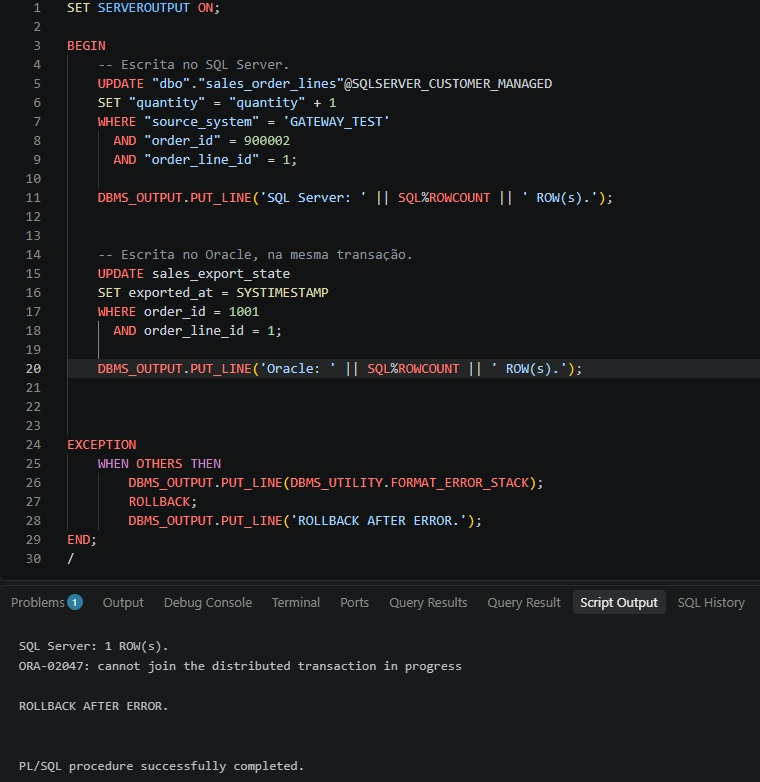

# Tests and observed results

Queries were executed through two clients: an Oracle connection using the database link and a direct SQL Server connection. The direct SQL Server queries confirmed the rows and values stored at the destination.

## Connection comparison

The connection without a gateway failed. The Oracle-managed connection returned rows with SELECT, but its INSERT test failed. The customer-managed connection through `dg4odbc` was then used for the data modification and export tests.

## Data operations

| Scripts | Test | Observed result |
| --- | --- | --- |
| 022–023 | INSERT and COMMIT for order 900001 | The row was returned through the Oracle link and directly in SQL Server. |
| 024–025 | Character test using `C@fé` | Both sides returned the same text. SQL Server reported four characters and eight bytes; its binary comparison returned PASS. |
| 026 | INSERT followed by ROLLBACK for order 900003 | The Oracle session returned the inserted row before rollback. Afterwards, Oracle and SQL Server counts both returned zero. |
| 027–028 | UPDATE and COMMIT for order 900001 | The updated quantity of 3.5 was verified directly in SQL Server. |
| 029–030 | DELETE and COMMIT for order 900001 | The subsequent counts returned zero matching rows. |
| 031–032 | Timestamp precision | Oracle and SQL Server both confirmed `2026-10-31 12:34:56.789`. |

The INSERT rollback test used an Oracle session with auto-commit disabled. Script 031 fetched the timestamp into a local PL/SQL variable and formatted it with DBMS_OUTPUT, making the fractional seconds visible independently of the result grid's date display.

The standalone test rows used `source_system = 'GATEWAY_TEST'`. The sales export used `ORACLE_ATP`, so its row counts excluded the remaining character-test row.

## Initial and incremental sales exports

Before the first export, the pending Oracle view contained six order lines and SQL Server contained no `ORACLE_ATP` rows.

Script 035 inserted the six rows and recorded their source versions in Oracle. The resulting Oracle counts were six source rows, zero pending rows and six tracking rows. The destination net amount total was 1020.70.

A second execution without source changes returned:

```text
No pending rows. Nothing to export.
```

For the incremental test, script 037 changed the discount on order 1003, line 2, from 30 to 40 and updated its source timestamp. The next export reported zero inserts and one update. SQL Server still contained six business rows; the changed line had a net amount of 458.00, and the total became 1010.70.

## Distributed update test (039)

Script 039 incremented the quantity of test row 900002 in SQL Server, then attempted to update `sales_export_state` in Oracle without an intermediate COMMIT.

Observed output on 2026-11-02:

```text
SQL Server: 1 ROW(s).
ORA-02047: cannot join the distributed transaction in progress
ROLLBACK AFTER ERROR.
```



The SQL Server UPDATE affected one row. The Oracle UPDATE was rejected before a final COMMIT, and the exception handler executed ROLLBACK. The final `PL/SQL procedure successfully completed` message reflected the handled exception, rather than successful completion of both updates.

This result explains the two transaction boundaries in script 035: the SQL Server writes are committed first, followed by the Oracle tracking changes. A failure between those commits can leave destination rows updated while their Oracle tracking records remain unchanged. The update-before-insert logic allows pending rows to be processed again in this single-writer example; recovery from that particular failure scenario was not tested.
